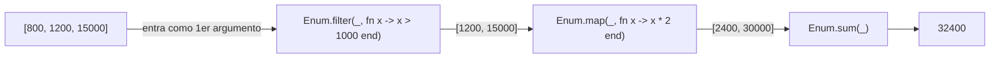
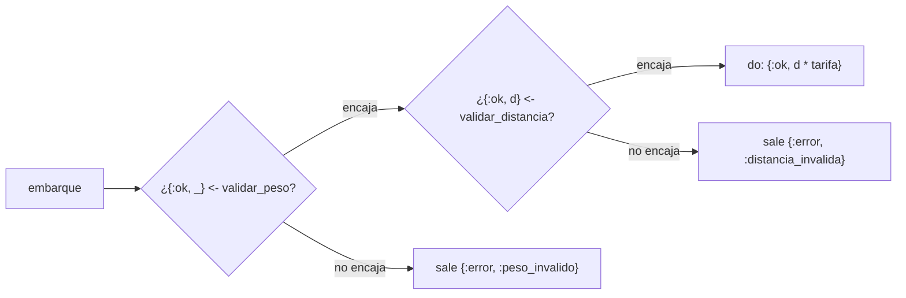
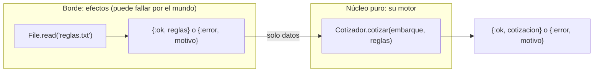

# Guía 05 · `|>`, `with` y la frontera de efectos

Unidad 2 · Elixir · **martes 13 de octubre**

**Cada fragmento se predice por escrito antes de ejecutarlo.** La respuesta está escondida debajo, en
"Respuesta". Si fallaste, lee el "por qué".

Lo de hoy, en su motor:

| Hoy aprendes | Dónde lo usan en el proyecto |
|---|---|
| `\|>` | `resumen/2` se escribe como una tubería |
| `with` | `cotizar/2`: validar, y solo si pasa, calcular |
| La frontera | El motor no lee archivos: recibe las reglas ya hechas datos |

**Antes de empezar:**

```bash
cd programacion-multiparadigma-2026
git pull
cd 05-pipe-y-with
iex fragmentos/pipe-with.exs
```

Ese `iex` no imprime nada. Ahí vas a escribir (o pegar) cada fragmento.

---

## Parte 1 · `|>`: el código se lee en el orden en que pasan las cosas

**La idea en una frase:** `x |> f(y)` es lo mismo que `f(x, y)`. Lo de la izquierda entra como
**primer argumento** de lo de la derecha.

### Fragmento 1

```elixir
Enum.sum(Enum.map(Enum.filter([800, 1200, 15_000], fn x -> x > 1000 end), fn x -> x * 2 end))
```

Antes de predecir, fíjate en **por dónde empezaste a leer**.

<details><summary>Respuesta</summary>

`32400`. Se quedan 1200 y 15000 (los de más de 1000), se duplican (2400 y 30000) y se suman.

**Por qué cuesta:** para entenderlo tuviste que leer **de adentro hacia afuera**: primero el
`filter`, que está en medio, luego el `map`, que lo envuelve, y al final el `sum`, que está al
principio. El orden en que se escribe es el contrario del orden en que pasa.
</details>

### Fragmento 2 (el mismo cálculo)

```elixir
[800, 1200, 15_000]
|> Enum.filter(fn x -> x > 1000 end)
|> Enum.map(fn x -> x * 2 end)
|> Enum.sum()
```

Pégalo completo en `iex`. Vas a ver salir cada paso por separado; el último es el resultado.

<details><summary>Respuesta</summary>

`32400`, igual. Pero ahora se lee de arriba abajo, como una receta: *"de esta lista, quédate con
los de más de 1000, duplícalos, súmalos"*.

`iex` te muestra cada renglón porque evalúa uno por uno: primero la lista, luego la lista filtrada
`[1200, 15000]`, luego `[2400, 30000]`, y al final `32400`. Es la tubería en cámara lenta.
</details>

### El dibujo



El `_` del dibujo es el hueco donde cae lo que viene por la tubería: **siempre el primer
argumento**. Por eso en Elixir casi todas las funciones de `Enum`, `String` y `Map` reciben "la
cosa" primero: están pensadas para ponerse en una tubería.

### Fragmentos 3 y 4 (la trampa)

```elixir
"a,b,c" |> String.split(",")
```

```elixir
"," |> String.split("a,b,c")
```

<details><summary>Respuesta</summary>

El 3 da `["a", "b", "c"]`: es `String.split("a,b,c", ",")`, partir el texto en las comas.

El 4 da `[","]`: es `String.split(",", "a,b,c")`, partir el texto `","` cada vez que aparezca
`"a,b,c"`. Como nunca aparece, regresa el texto entero en una lista.

**Por qué importa:** `|>` no adivina dónde va el valor. Siempre lo pone **primero**. Si lo que
quieres pasar no es el primer argumento de la función, la tubería no te sirve tal cual.
</details>

### Ejercicios de la parte 1

```bash
cd ejercicios
mix test test/camino_test.exs
```

Todas arrancan en rojo. Haz `total_pesados/2` y `lista_de_ids/1` en `lib/camino.ex` (pruebas 1 y 2).
**Regla:** cada una es **una sola tubería**, sin variables intermedias.

---

## Parte 2 · `with`: el camino feliz

**La idea en una frase:** cuando un cálculo tiene varios pasos y **cualquiera puede fallar**,
`with` escribe solo el camino feliz; si un paso falla, ese error sale tal cual y los demás pasos ni
se intentan.

### El problema que resuelve

Su `cotizar/2` primero valida y después calcula. Con lo que ya saben, se escribiría así:

```elixir
case validar_peso(e) do
  {:ok, _} ->
    case validar_distancia(e) do
      {:ok, d} -> {:ok, d * tarifa}
      error -> error
    end

  error ->
    error
end
```

Con dos pasos ya es una escalera. Su motor tiene siete motivos de rechazo: serían siete escalones.

### Fragmento 5

```elixir
with {:ok, peso} <- {:ok, 9000},
     {:ok, distancia} <- {:ok, 200} do
  peso + distancia
end
```

<details><summary>Respuesta</summary>

`9200`. Cada renglón `patrón <- expresión` es una **coincidencia de patrones** como las del 6 de
octubre: si `{:ok, 9000}` encaja en `{:ok, peso}`, `peso` vale 9000 y se pasa al siguiente renglón.
Los dos encajaron, así que se ejecuta el `do`.
</details>

### Fragmento 6 (el segundo paso falla)

```elixir
with {:ok, peso} <- {:ok, 9000},
     {:ok, distancia} <- {:error, :distancia_invalida} do
  peso + distancia
end
```

<details><summary>Respuesta</summary>

`{:error, :distancia_invalida}`. El segundo renglón **no encajó**: `{:error, ...}` no tiene la forma
`{:ok, distancia}`. En ese momento `with` se detiene y regresa **exactamente lo que no encajó**. El
`do` nunca se ejecuta.

Esto es justo lo que quiere su motor: el **primer** motivo de rechazo sale tal cual, y los demás
ni se revisan.
</details>

### El dibujo: las vías del tren



La vía de arriba es el camino feliz: es lo único que escribes. Cada paso tiene una salida de
emergencia, y por ella sale el valor que no encajó, sin tocarlo.

### Fragmentos 7 y 8: `else`

`Integer.parse/1` convierte texto en entero y regresa `{numero, lo_que_sobró}`.

```elixir
with {n, ""} <- Integer.parse("12x") do
  n
end
```

```elixir
with {n, ""} <- Integer.parse("12x") do
  n
else
  _ -> :no_es_numero
end
```

<details><summary>Respuesta</summary>

El 7 da `{12, "x"}`. `Integer.parse("12x")` leyó el 12 y le sobró `"x"`. Eso no encaja con
`{n, ""}` (que pide que no sobre nada), así que `with` regresa lo que no encajó: `{12, "x"}`.

El 8 da `:no_es_numero`. Con `else`, lo que no encajó **no sale directo**: pasa por las cláusulas
del `else`, como en un `case`. Úsalo cuando el error que te llega no es el que quieres regresar.
</details>

### Ejercicios de la parte 2

Pruebas 3, 4 y 5. `validar_peso/1` y `validar_distancia/1` son de dos cláusulas cada una (una con
guarda). `cotizar_simple/2` es **un solo `with`**, sin `if` ni `case`.

---

## Parte 3 · La frontera de efectos

**La idea en una frase:** el motor es **puro** (mismos datos, mismo resultado, siempre); todo lo que
toca el mundo (leer un archivo, la hora, la red) vive **afuera**, en el borde, y le pasa datos al
motor.

### Fragmento 9

```elixir
File.read("no-existe.txt")
```

<details><summary>Respuesta</summary>

`{:error, :enoent}` ("error, no existe la entrada"). Leer un archivo **puede fallar por razones que
no dependen de tu código**: el archivo no está, no tienes permiso, el disco falla. Por eso
`File.read/1` no regresa el texto: regresa `{:ok, texto}` o `{:error, motivo}`. Es la misma forma que
sus validaciones, así que se encadena con `with` igual que ellas.
</details>

### El dibujo: la cebolla



**Por qué así:** una función pura se prueba sin preparar nada (sin crear archivos, sin internet): le
das datos y comparas el resultado. Por eso **sus pruebas de aceptación le pasan las reglas como un
mapa** y no como un archivo. Si su motor leyera las reglas de un archivo, cada prueba tendría que
crear ese archivo. El enunciado lo pide así: *"Las reglas llegan como argumento"*.

### Ejercicios de la parte 3

Pruebas 6 y 7. `leer_tarifa/1` es un `with` de dos pasos (`File.read` y `Integer.parse`) con un
`else` que traduce los errores. Fíjate en que las pruebas 6 y 7 sí tienen que crear archivos: eso es
lo que cuesta probar el borde.

---

## Revísate (tipo checkpoint)

1. Reescribe con `|>`: `Enum.join(Enum.map(ids, &String.upcase/1), "-")`.
2. ¿Qué regresa esto? `with {:ok, x} <- {:ok, 1}, {:ok, y} <- :error, do: x + y`
3. ¿Y esto?
   ```elixir
   with {:ok, x} <- {:ok, 1},
        {:ok, y} <- :error do
     x + y
   else
     :error -> {:error, :falta_y}
   end
   ```
4. ¿Por qué una función que lee un archivo no puede ser pura?

<details><summary>Respuestas</summary>

1. `ids |> Enum.map(&String.upcase/1) |> Enum.join("-")`
2. `:error`: el segundo renglón no encaja y sale tal cual.
3. Regresa `{:error, :falta_y}`: lo que no encajó pasa por el `else`.
4. Porque su resultado depende de algo que no está en sus argumentos (lo que haya en el disco en ese
   momento). Con los mismos argumentos puede dar resultados distintos.
</details>

**Para profundizar:** Lectura 5 de `LECTURAS-UNIDAD-2.md`.

## Si te atoras

Pregunta en el canal de la materia en Teams, con este formato (así se contesta rápido):

> **Guía 05, prueba 5.** Esperaba `{:error, :peso_invalido}` y me sale `...`. Mi código:
> ```elixir
> (pega solo la función)
> ```
