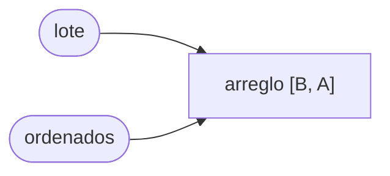
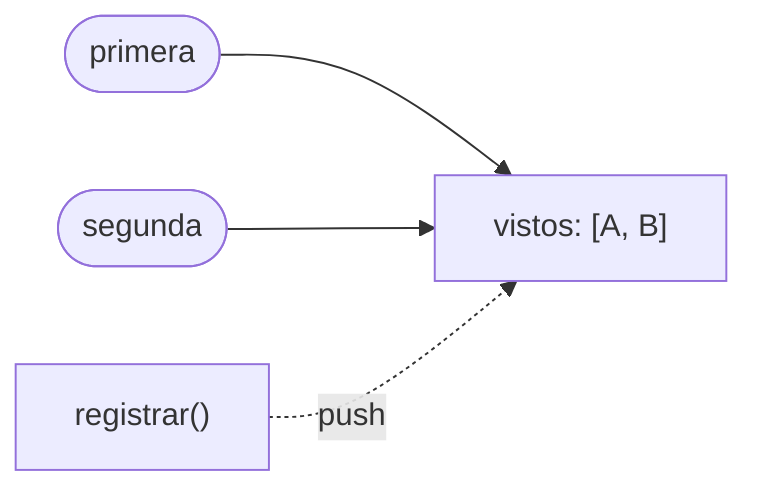
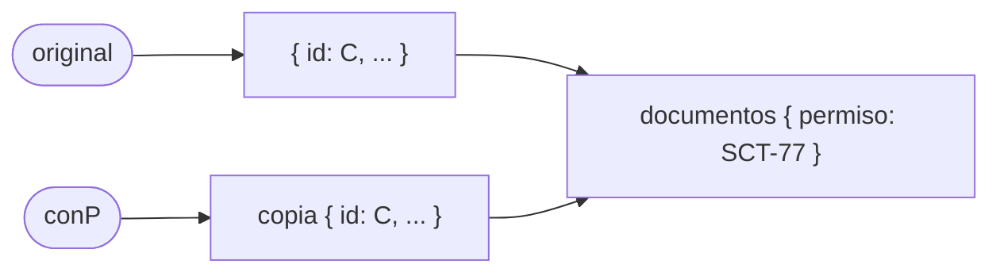

# Taller 3 · La mutación escondida

Unidad 2 · **individual** · jueves 15 de octubre
**Entrega: viernes 16 de octubre, 23:59** · `talleres/16-oct/<tu número de control>/`

Cinco funciones de TypeScript que reciben algo y regresan algo, pero por dentro **cambian lo que les
prestaste**.

**Lo que entregas:** tu `escondida.ex` (las cinco en Elixir, con pruebas en verde) y tu
`respuestas.md` (la plantilla llena).

---

## Paso 1 · Predecir

Abre `escondida.ts` y lee las cinco funciones y la demostración de abajo. **Sin ejecutar nada**,
copia `respuestas-plantilla.md` y llena la columna "Predigo" con lo que crees que imprime cada línea
de la demostración.

En cada línea fíjate en dos cosas: qué valor sale, y si la comparación con `===` da `true` o `false`.
`a === b` con objetos o arreglos no compara el contenido: pregunta **si son la misma caja**.

## Paso 2 · Ejecutar y comparar

```bash
cd programacion-multiparadigma-2026/06-mutacion-escondida
npx tsx escondida.ts
```

(La primera vez `npx` pide permiso para descargar `tsx`: contesta `y`.)

Llena la columna "Salió". Si una predicción falló, **no la borres**.

## Paso 3 · Entender cada una

Para cada función, abre su explicación **después** de haber comparado. En la plantilla escribe, con tus
palabras, qué línea muta y quién más se entera.

<details><summary>1 · ordenarPorPeso</summary>

Salió `1 · B,A true`. `sort` **no hace un arreglo nuevo**: reordena el mismo arreglo y lo regresa.
Por eso `lote`, que tú no tocaste, quedó ordenado, y `ordenados === lote` es `true`: son la misma caja
con dos etiquetas.



**Quién más se entera:** cualquiera que tenga una referencia a ese arreglo, por ejemplo otra pantalla
que mostraba los embarques en el orden en que llegaron.
**Arreglo en TypeScript:** `embarques.toSorted(...)` (hace uno nuevo) o `[...embarques].sort(...)`.
</details>

<details><summary>2 · conDescuento</summary>

Salió `2 · 10 true`. La función escribe **dentro** del objeto que recibió (`reglas.descuentoPct = pct`)
y regresa ese mismo objeto. Tus reglas `base` cambiaron de 5 a 10 sin que tú lo pidieras. Si `base`
eran las reglas de todos los clientes, ahora todos tienen la promoción.

**Arreglo en TypeScript:** `return { ...reglas, descuentoPct: pct };` (un objeto nuevo).
</details>

<details><summary>3 · registrar</summary>

Salió `3 · 2 true`. `vistos` vive **afuera** de la función y es de todos. Cada llamada le hace `push`,
y además te regresa **la caja compartida**, no una copia. Por eso `primera`, que se guardó cuando solo
había un id, ahora tiene dos: `primera` y `segunda` son el mismo arreglo.



Este es el más peligroso: la función da resultados distintos con el mismo argumento, según cuántas
veces se haya llamado antes. **No es pura.**
**Arreglo:** que la lista entre como argumento y salga una nueva: `registrar(vistos, id)` regresa
`[...vistos, id]`. Es lo que vas a escribir en Elixir.
</details>

<details><summary>4 · conPermiso</summary>

Salió `4 · SCT-77 false`. ¡El `false` engaña! La copia **sí** es otra caja (`{ ...e }`), pero el
spread copia solo el **primer nivel**: `copia.documentos` y `original.documentos` siguen siendo **el
mismo objeto**. Escribir en `copia.documentos.permiso` escribe en el de los dos.



Es exactamente la pregunta del examen diagnóstico: dos cajas de arriba, una sola caja de abajo.
**Arreglo:** copiar los dos niveles:
`return { ...e, documentos: { ...e.documentos, permiso } };`
</details>

<details><summary>5 · fechaDeEntrega</summary>

Salió `5 · 15 15`. En JavaScript, `Date` es un objeto **mutable**: `setDate` cambia la fecha que
recibiste. La salida del 12 se volvió 15. Si esa fecha venía de la base de datos, ahora el embarque
"salió" tres días después.

**Arreglo:** trabajar sobre una fecha nueva:
`const r = new Date(salida); r.setDate(r.getDate() + dias); return r;`
En Elixir, `Date.add/2` regresa una fecha nueva y no hay forma de cambiar la vieja.
</details>

## Paso 4 · Las cinco en Elixir

```bash
cd ejercicios
mix test test/escondida_test.exs
```

Las cinco arrancan en rojo; las pistas están en `lib/escondida.ex`. Fíjate en la **última aserción de
cada prueba**: revisa que el original sigue igual. En TypeScript esa línea fallaría. En Elixir no puede
fallar, y en la plantilla tienes que explicar por qué.

La 4 es la que más cuesta: `documentos` es un mapa dentro de otro mapa, y hay que hacer uno nuevo en
los dos niveles: `%{embarque | documentos: %{embarque.documentos | permiso: permiso}}`. Fíjate en que
es la misma forma que el arreglo de TypeScript.

## Paso 5 · Entregar

En el repositorio de tu equipo (`cotizador-eNN`), en tu carpeta, **antes del viernes 16 a las 23:59**.
Supone que este repositorio y el de tu equipo están clonados uno junto al otro.

```bash
cd cotizador-eNN
git switch main && git pull
git switch -c taller/16-oct-<control>

mkdir -p talleres/16-oct/<control>
cp ../programacion-multiparadigma-2026/06-mutacion-escondida/ejercicios/lib/escondida.ex talleres/16-oct/<control>/
cp ../programacion-multiparadigma-2026/06-mutacion-escondida/respuestas-plantilla.md talleres/16-oct/<control>/respuestas.md
# llena respuestas.md (o copia la que ya llenaste)

git add talleres
git commit -m "docs: entrega del taller la mutación escondida"
git push -u origin taller/16-oct-<control>
```

Abre el PR. Tu compañero lo aprueba y lo integra con **Create a merge commit** (no squash): cuenta la
hora de tu commit, no la del merge.

**Si todavía no tienes equipo:** el lunes 12 se cierran los equipos (ver `SEMANA-DEL-12-OCT.md`). En
cuanto tengas tu repositorio, entregas ahí; la fecha es la misma.
