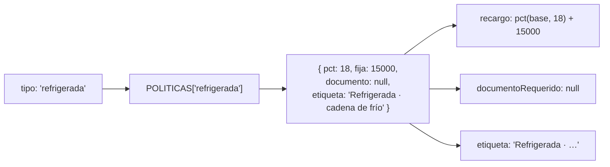

# Taller 4 · De condicionales a despacho

Unidad 3 · TypeScript · **individual**
**Entrega: viernes 23 de octubre, 23:59** · `talleres/23-oct/<tu número de control>/`

En Elixir decidían por tipo de carga con **cláusulas**: una por caso, y Elixir escogía la que
encajaba. En TypeScript se decide con **despacho**: cada tipo de carga es una **entrada en una tabla**
con su política, y el código solo consulta la tabla. Es lo que pide su modelo: *"cero `switch` o
cadenas de `if` sobre el tipo de carga"*.

**Entregas:** tu `despacho.ts` (con `npm run verificar` en verde) y tu `respuestas.md`.

```bash
cd programacion-multiparadigma-2026
git pull
cd 07-despacho
npm install
```

---

## Paso 1 · La versión con `switch`

Abre `src/condicionales.ts`. Son tres funciones, y las tres preguntan por el tipo con un `switch`.

```bash
npm run condicionales
```

Ahora el cliente pide un tipo nuevo: **perecedera**, que paga **12 % + $200**, no pide documento, y
su etiqueta es **"Perecedera · caduca en 72 h"**.

**Antes de tocar nada**, contesta en `respuestas.md`: ¿cuántos lugares del archivo hay que cambiar?

Luego haz **solo esto**: agrega `'perecedera'` al tipo `Tipo` (primera línea) y en la demostración
de abajo agrégalo a la lista `tipos`. No toques los `switch`. Corre:

```bash
npx tsc --noEmit
npm run condicionales
```

<details><summary>Qué pasó y por qué</summary>

`tsc` no se queja, y la demostración imprime `perecedera  0  null  General`. Las tres funciones
tienen un `default`, así que el tipo nuevo cae ahí **en silencio**: recargo 0 y etiqueta "General".
Un embarque perecedero se cotizaría sin su recargo, y nadie se entera hasta que alguien revisa una
factura.

El tipo nuevo había que agregarlo en **cuatro** lugares (el tipo y tres `switch`), y el compilador no
te avisa de los tres que faltan. Con 10 tipos de carga y 8 funciones, son 80 casos repartidos por todo
el código.
</details>

Deja `condicionales.ts` como estaba (`git checkout src/condicionales.ts`).

---

## Paso 2 · La versión con tabla



Abre `src/despacho.ts`:

1. Llena `POLITICAS` con los valores de `condicionales.ts`: una entrada por tipo.
2. Borra el `as Record<Tipo, Politica>` del final de la tabla.
3. Escribe las tres funciones. Cada una es **una consulta** a la tabla, de una línea.

```bash
npm test
```

Pasan las pruebas del "paso 2"; las del "paso 3" siguen en rojo.

<details><summary>Pista · recargo</summary>

`POLITICAS[tipo]` es la política completa. `recargo` es `pct(base, ...)` más la parte fija de esa
política.
</details>

**`Record<Tipo, Politica>`** es un objeto que **tiene que** tener una llave por cada valor de `Tipo`.
Fíjate en eso para el paso 3.

---

## Paso 3 · El tipo nuevo, otra vez

Agrega `'perecedera'` a `Tipo` en `despacho.ts`, y corre:

```bash
npx tsc --noEmit
```

<details><summary>Qué pasó y por qué</summary>

Ahora `tsc` **sí** se queja: a `POLITICAS` le falta la llave `perecedera`. `Record<Tipo, Politica>`
le dice al compilador que la tabla debe estar completa, así que olvidar un tipo ya no es silencioso:
no compila.

Agrega la entrada de perecedera a la tabla. Es **el único lugar** que cambia: las tres funciones no
se tocan.
</details>

```bash
npm run verificar
```

Todo en verde.

---

## Lo mismo en los dos lenguajes

| | Elixir (su motor) | TypeScript (su modelo) |
|---|---|---|
| Cómo se decide por tipo | Una **cláusula** por tipo; el patrón escoge | Una **entrada** por tipo en la tabla; la llave escoge |
| Agregar un tipo | Agregar una cláusula | Agregar una entrada |
| Si olvidas un tipo | `FunctionClauseError` al ejecutar | Error de compilación, con `Record<Tipo, …>` |

---

## Entregar

En el repositorio de tu equipo (`cotizador-eNN`), en tu carpeta, **antes del viernes 23 a las 23:59**:

```bash
cd cotizador-eNN
git switch main && git pull
git switch -c taller/23-oct-<control>

mkdir -p talleres/23-oct/<control>
cp ../programacion-multiparadigma-2026/07-despacho/src/despacho.ts talleres/23-oct/<control>/
cp ../programacion-multiparadigma-2026/07-despacho/respuestas-plantilla.md talleres/23-oct/<control>/respuestas.md
# llena respuestas.md

git add talleres
git commit -m "docs: entrega del taller de condicionales a despacho"
git push -u origin taller/23-oct-<control>
```

Abre el PR. Tu compañero lo aprueba y lo integra con **Create a merge commit**.

La carpeta se llama `talleres` (minúscula) y la fecha `23-oct`, exactamente así.
