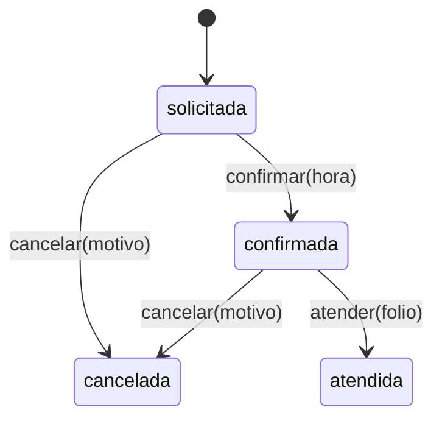

# Guía 08 · Uniones discriminadas: el estado que no se puede escribir

Unidad 3 · TypeScript · **jueves 22 de octubre**

**La idea:** si un estado no puede existir en el negocio, que **no se pueda escribir** en el código.
El compilador lo rechaza antes de que el programa corra.

Es lo que pide su modelo: las ocho líneas con `@ts-expect-error` al final de sus pruebas de
aceptación. Aquí lo practican con otro dominio: una **cita en la aduana**.

```bash
cd programacion-multiparadigma-2026
git pull
cd 08-uniones
npm install
npm run verificar
```

Todo sale en rojo: 6 errores de tipos y 6 pruebas.

---

## 1 · El problema: un tipo que acepta todo

Abre `src/cita.ts`. Hoy una cita es **un solo tipo con campos opcionales**:

```ts
type Cita = { estado: string; pedimento: string; hora?: string; motivo?: string; folio?: string; ... };
```

Con ese tipo, esto compila:

```ts
const c: Cita = { estado: 'atendida', pedimento: 'P-1', mercancia: { tipo: 'general' } };
```

Una cita **atendida sin hora y sin folio**. En el negocio no existe; en el código sí. Y quien lea
`c.folio` tiene que acordarse de revisar si es `undefined`, en cada lugar.

## 2 · La solución: un tipo por estado



Cada estado es **su propio tipo**, con **solo** los campos que tiene en ese estado. Todos comparten un
campo literal, `estado`, que los distingue:

```ts
type Solicitada = { estado: 'solicitada'; pedimento: string; mercancia: Mercancia };
type Confirmada = { estado: 'confirmada'; pedimento: string; mercancia: Mercancia; hora: string };
// ... Cancelada con motivo, Atendida con hora y folio

type Cita = Solicitada | Confirmada | Cancelada | Atendida;
```

Eso es una **unión discriminada**: una de cuatro formas, y `estado` dice cuál.

- `estado: 'confirmada'` no es un `string`: es **exactamente** ese texto. Por eso `'extraviada'` no
  compila.
- `hora: string` sin `?`: una confirmada **siempre** tiene hora.
- Una cancelada **no tiene** el campo `hora`. Leer `c.hora` en una cancelada no compila.

### Las funciones dicen de qué estado a qué estado

```ts
function atender(c: Confirmada, folio: string): Atendida
```

La firma es la regla del negocio: solo una confirmada se atiende. `atender(solicitada, 'A-1')` no
compila.

### Predice: ¿compila o no?

```ts
function horaDe(c: Cita): string {
  if (c.estado === 'confirmada') return c.hora;
  return 'sin hora';
}
```

<details><summary>Respuesta</summary>

**Sí compila.** Dentro del `if`, TypeScript ya sabe que `c` es `Confirmada` (eso se llama
*estrechamiento*), y una `Confirmada` sí tiene `hora`. Fuera del `if`, `c.hora` no compilaría: `c`
podría ser una solicitada.
</details>

### Lo mismo para la mercancía

Una mercancía peligrosa exige número UN. Otra unión discriminada, ahora por `tipo`:

```ts
type Mercancia = { tipo: 'general' } | { tipo: 'peligrosa'; numeroUn: string };
```

`{ tipo: 'peligrosa' }` sin `numeroUn` no compila.

## 3 · `Resultado<T, E>`: el `{:ok, _} | {:error, _}` de Elixir

`confirmar` puede fallar (fuera de horario). En Elixir regresaban `{:ok, valor}` o `{:error, motivo}`.
En TypeScript es otra unión discriminada, **genérica**:

```ts
type Resultado<T, E> = { ok: true; valor: T } | { ok: false; error: E };
```

`T` y `E` son huecos para tipos: `Resultado<Confirmada, Motivo>` es "o una confirmada, o un motivo".
Quien lo recibe **tiene que** preguntar `if (r.ok)` antes de leer `r.valor`: sin esa pregunta, no
compila.

## 4 · `switch` sobre el estado, completo

```ts
function describir(c: Cita): string {
  switch (c.estado) {
    case 'solicitada': return ...;
    case 'confirmada': return ...;   // aquí c.hora existe
    case 'cancelada':  return ...;   // aquí c.motivo existe
    case 'atendida':   return ...;   // aquí c.folio existe
    default: {
      const imposible: never = c;
      return imposible;
    }
  }
}
```

El `default` con `never` es una alarma: si mañana agregan un quinto estado y olvidan su `case`, ahí
`c` ya no es `never` y **no compila**. Es el mismo efecto que `Record<Tipo, …>` en el taller 4.

Un `switch` sobre **el estado** está bien. Lo que su modelo prohíbe es el `switch` sobre **el tipo de
carga**: eso va en una tabla.

---

## Ejercicios

En `src/cita.ts`:

1. Reescribe los tipos como en la sección 2, más `Motivo = 'sin_documentos' | 'fuera_de_horario'` y
   `Resultado<T, E>`.
2. Escribe las cuatro funciones. Horario de confirmación: de `'08:00'` a `'17:59'` (los textos
   `"HH:MM"` se comparan con `<` y `>=` como texto).

```bash
npm run verificar
```

**Listo cuando:** `tsc` en verde (las 6 líneas de `tests/no-compila.ts` ya no compilan, que es lo que
se busca) y las 6 pruebas en verde.

<details><summary>Pista · el error dice "Unused '@ts-expect-error' directive"</summary>

Esa línea **compiló**, y no debía. Tu tipo todavía acepta ese estado imposible. Busca qué campo
opcional o qué `string` hay que volver un literal o quitar.
</details>

<details><summary>Pista · atender sin repetir campos</summary>

`{ ...c, estado: 'atendida', folio }` copia la confirmada y cambia el estado. Es un objeto nuevo: la
confirmada original no cambia (prueba 5).
</details>

## Revísate (tipo checkpoint)

1. ¿Qué gana `estado: 'confirmada'` contra `estado: string`?
2. ¿Por qué `atender(c: Confirmada, …)` es mejor que `atender(c: Cita, …)` con un `if` adentro?
3. En Elixir, ¿cuál es el equivalente de `Resultado<T, E>`?

<details><summary>Respuestas</summary>

1. El compilador distingue los cuatro estados y rechaza los que no existen.
2. El error aparece al compilar, en quien llama mal, y no al ejecutar.
3. `{:ok, valor} | {:error, motivo}`, que su motor ya regresa.
</details>
