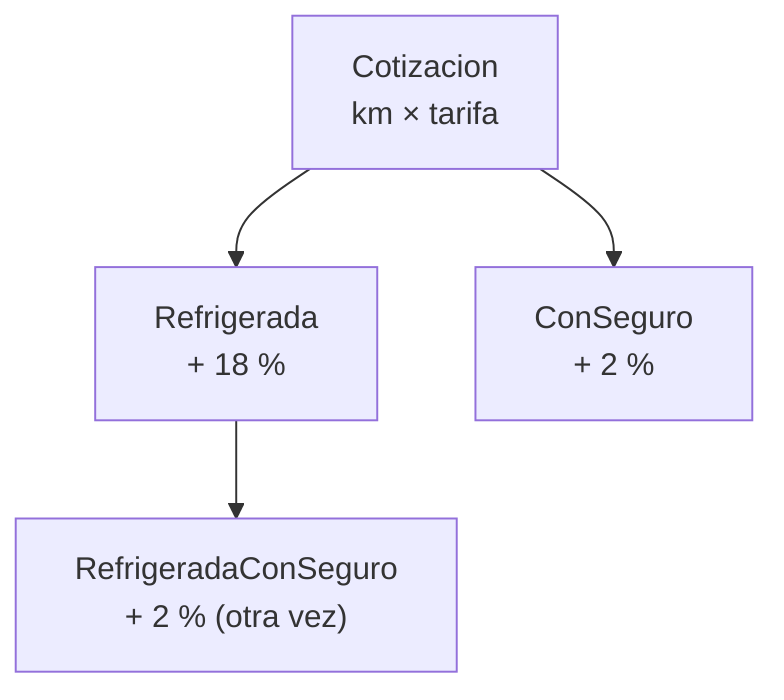
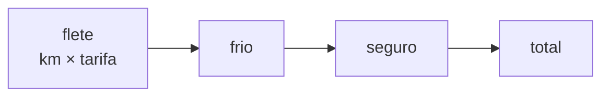

# Taller 5 · Composición o herencia

Unidad 3 · TypeScript · **individual**
**Entrega: martes 27 de octubre, 23:59** · `talleres/27-oct/<tu número de control>/`

Una cotización puede llevar extras: **frío** (+18 %), **seguro** (+2 %) y **express** (+$500). Hay dos
formas de programarlo: con **herencia**, una clase por cada combinación de extras; o con
**composición**, una función por extra y una lista con los que lleva cada cotización. Su modelo pide
la segunda: *"composición, no herencia, para los pasos del cálculo"*. Hoy ven por qué, y cuándo la
herencia sí se defiende.

**Entregas:** tu `composicion.ts` (con `npm run verificar` en verde) y tu `respuestas.md`.

```bash
cd programacion-multiparadigma-2026
git pull
cd 09-composicion
npm install
```

---

## Paso 1 · La versión con herencia

Abre `src/herencia.ts` y corre:

```bash
npm run herencia
```

Hay cuatro clases para dos extras: sin extras, con frío, con seguro, y con frío **y** seguro.



Contesta en `respuestas.md` **antes** de abrir la explicación:

1. ¿En qué dos clases está escrito el cálculo del seguro?
2. Llega un tercer extra, **express**. Para cubrir todas las combinaciones, ¿cuántas clases habría en
   total? ¿Cuántas son nuevas?

<details><summary>Explicación</summary>

1. En `ConSeguro` y en `RefrigeradaConSeguro`. `RefrigeradaConSeguro` hereda de `Refrigerada`, así
   que obtiene el frío, pero no puede heredar también de `ConSeguro`: en TypeScript una clase hereda
   de **una sola**. El seguro se copia.
2. Cada extra se lleva o no se lleva: con 3 extras son 2 × 2 × 2 = **8** combinaciones, así que 8
   clases. Hoy hay 4; son **4 nuevas** (express solo, frío + express, seguro + express y los tres). Con
   un cuarto extra serían 16.

Esa es la explosión de combinaciones: la herencia organiza **una** dimensión de variación; cuando
hay varias que se combinan, las clases se multiplican y el código se repite.
</details>

---

## Paso 2 · La versión con composición

La idea: un extra es una **función** que recibe un monto y regresa otro. Una cotización es el flete
más **la lista de extras que lleva**, aplicados uno tras otro.



`[frio, seguro]` es "refrigerada con seguro". `[frio, seguro, express]` es "los tres". No hace falta
una clase por combinación: la combinación es la lista.

Abre `src/composicion.ts`:

1. Escribe los tres ajustes, de una línea cada uno.
2. Escribe `cotizar`: el flete, y encima cada ajuste en el orden de la lista.

<details><summary>Pista · cotizar es un reduce</summary>

El acumulador empieza en el flete (`km * tarifaKm`), y cada paso aplica el siguiente ajuste al
acumulador: `ajustes.reduce((monto, ajuste) => ajuste(monto), km * tarifaKm)`. Es el `reduce` de la
unidad 2, ahora en TypeScript.
</details>

```bash
npm run verificar
npm run demo
```

La prueba 5 compara tus resultados con los de `herencia.ts`: **los mismos centavos**. La 6 cotiza
una combinación que la versión con herencia ni siquiera tiene.

---

## Paso 3 · El orden importa

```ts
cotizar(100, 1000, [express, seguro])   // ?
cotizar(100, 1000, [seguro, express])   // ?
```

Predice los dos resultados en `respuestas.md` y luego compáralos con la prueba 7.

<details><summary>Explicación</summary>

153000 y 152000. Con express primero, el seguro cobra su 2 % **también sobre los $500**; con el seguro
primero, no. En la lista el orden está escrito a la vista y se puede discutir. En una jerarquía de
clases está escondido en quién llama a `super.total()` y cuándo.
</details>

---

## Paso 4 · ¿Y cuándo sí herencia?

La herencia no está prohibida. Se defiende cuando hay **una sola** dimensión de variación, una
relación "es un" que no cambia, y el padre trae comportamiento que todos los hijos usan sin
modificarlo. Ejemplo típico en TypeScript:

```ts
class EmbarqueRechazado extends Error {
  constructor(readonly motivo: string) {
    super(`embarque rechazado: ${motivo}`);
  }
}
```

`EmbarqueRechazado` **es un** `Error`: hereda el mensaje y el rastro de la pila, y cualquier
`try/catch` lo trata como error. No hay combinaciones que explotar.

En `respuestas.md`, la pregunta final te pide sostener una decisión: es el tipo de pregunta de la
defensa.

---

## Entregar

En el repositorio de tu equipo, **antes del martes 27 a las 23:59**:

```bash
cd cotizador-eNN
git switch main && git pull
git switch -c taller/27-oct-<control>

mkdir -p talleres/27-oct/<control>
cp ../programacion-multiparadigma-2026/09-composicion/src/composicion.ts talleres/27-oct/<control>/
cp ../programacion-multiparadigma-2026/09-composicion/respuestas-plantilla.md talleres/27-oct/<control>/respuestas.md
# llena respuestas.md

git add talleres
git commit -m "docs: entrega del taller composición o herencia"
git push -u origin taller/27-oct-<control>
```

Abre el PR. Tu compañero lo aprueba y lo integra con **Create a merge commit**.

La carpeta se llama `talleres` (minúscula) y la fecha `27-oct`, exactamente así.
