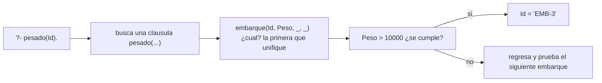
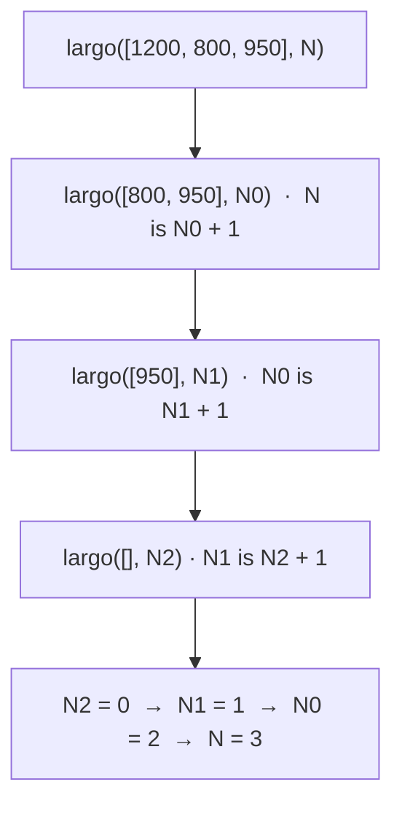

# Guía 10 · Hechos, reglas y consultas

Unidad 4 · Prolog · lunes 9 y jueves 12 de noviembre

Dos archivos de fragmentos: `fragmentos/lunes.pl` (hechos, reglas y consultas) y
`fragmentos/jueves.pl` (aritmética, listas y recursión). Cada fragmento es una **consulta**: escribe
tu predicción, ejecútala y lee por qué salió eso.

## Cómo correr los fragmentos

**En el navegador, sin instalar nada:** abre <https://swish.swi-prolog.org>, pega el archivo completo en
el panel izquierdo (*Program*) y escribe cada consulta en el panel derecho, abajo (*Query*). Si una
consulta tiene más de una respuesta, SWISH muestra un botón **Next**.

**Con `swipl` instalado** (lo van a necesitar para las pruebas del proyecto, aunque el CI también
las corre):

```bash
cd 10-hechos-y-reglas
swipl fragmentos/lunes.pl
```

Aparece el prompt `?-`. Escribe la consulta **con su punto final** y Enter. Si hay más respuestas,
Prolog se queda esperando: `;` pide la siguiente, Enter termina. Para salir: `halt.`

Instalación de `swipl`: en macOS, `brew install swi-prolog`; en Windows, el instalador de
<https://www.swi-prolog.org/download/stable>; en Ubuntu, `sudo apt install swi-prolog`.

---

## Lunes 9 · Describes qué es verdad; el motor busca cómo

Un programa en Prolog no tiene instrucciones. Tiene **hechos** (cosas que son verdad), **reglas**
(cómo se deduce algo a partir de otras cosas) y **consultas** (preguntas). El motor busca si lo que
preguntas se puede demostrar con lo que le diste.

```prolog
puente(comercio_mundial, nuevo_laredo).     % hecho: esto es verdad
carga(peligrosa).                           % hecho
requiere(peligrosa, numero_un).             % hecho

pesado(Id) :- embarque(Id, Peso, _, _), Peso > 10000.     % regla: Id es pesado SI ...
```

- Lo que empieza con **minúscula** es una constante (un átomo): `peligrosa`, `colombia`.
- Lo que empieza con **mayúscula** es una **variable**: `Id`, `Peso`. `_` es una variable que no te
  importa.
- `:-` se lee "si". Las comas del cuerpo se leen "y".
- Las cadenas con guiones o espacios van entre comillas simples: `'EMB-1'`.



### Fragmentos y respuestas

| # | Consulta | Respuesta | Por qué |
|---|---|---|---|
| 1 | `carga(peligrosa).` | `true` | Hay un hecho idéntico. |
| 2 | `carga(granel).` | `false` | No hay ningún hecho `carga(granel)`. `false` no es "es falso": es **"no lo pude demostrar"**. |
| 3 | `embarque('EMB-2', Peso, Tipo, Puente).` | `Peso = 9000, Tipo = refrigerada, Puente = colombia` | Una consulta con variables es una pregunta: ¿con qué valores es verdad? |
| 4 | `embarque(Id, _, _, colombia).` | `'EMB-2'`; con `;`: `'EMB-4'`, `'EMB-5'` | Tres hechos unifican. Prolog los da **en el orden del archivo**. |
| 5 | `pesado(Id).` | `'EMB-3'`; luego `'EMB-4'` | La regla prueba cada embarque; solo dos pasan la guarda `Peso > 10000`. |
| 6 | `documentado('EMB-4').` | `false` | Es sobredimensionada: requiere `permiso` y no hay `trae('EMB-4', permiso)`. Ninguna de las dos cláusulas se demuestra. |
| 7 | `documentado(Id).` | `'EMB-1'`, `'EMB-2'`, `'EMB-5'`, y al final `'EMB-3'` | Primero **agota la primera cláusula** (los que no requieren nada) y luego pasa a la segunda (los que traen su documento). El orden de las respuestas es el orden de las cláusulas. |
| 8 | `juntos('EMB-1', Otro).` | `'EMB-3'` | Mismo puente (`comercio_mundial`) y `A \== B` descarta al mismo embarque. |

**Lo que hay que llevarse:** en el motor de Elixir escribieron `validar/2` con una cláusula por motivo.
Aquí es lo mismo, pero el motor no solo *elige* la cláusula: si una falla, **regresa y prueba la
siguiente** (eso se llama *backtracking*). Por eso `documentado(Id)` da cuatro respuestas sin que
nadie escriba un ciclo.

---

## Jueves 12 · Aritmética, listas y recursión

### `=` no calcula; `is` sí

| # | Consulta | Respuesta | Por qué |
|---|---|---|---|
| 1 | `X = 3 + 4.` | `X = 3+4` | `=` **unifica**: `X` queda ligada al **término** `3+4`, sin evaluar. |
| 2 | `X is 3 + 4.` | `X = 7` | `is` evalúa la derecha y unifica con la izquierda. |
| 3 | `7 is 3 + 4.` | `true` | Evalúa 7 y unifica con 7. |
| 4 | `X is (790000 * 5 + 50) // 100.` | `X = 39500` | `//` es división entera. Es el redondeo de su cotizador. |
| 5 | `pct(790000, 5, D).` | `D = 39500` | El descuento del ejemplo del enunciado. |
| 6 | `pct(792500, 18, R).` | `R = 142650` | El recargo de la refrigerada (antes de la cuota fija). |

**Regla práctica:** la derecha de `is` tiene que estar **completamente ligada** a números. `X is Y + 1`
con `Y` libre es un error, no una ecuación.

### Listas: cabeza y cola

| # | Consulta | Respuesta |
|---|---|---|
| 7 | `[C \| R] = [1200, 800, 950].` | `C = 1200, R = [800, 950]` |
| 8 | `[_, Segundo \| _] = [1200, 800, 950].` | `Segundo = 800` |

### Recursión: el caso base y el paso

```prolog
largo([], 0).                                  % caso base: la lista vacia mide 0
largo([_ | R], N) :- largo(R, N0), N is N0 + 1. % paso: mide el resto y suma 1
```



Es la receta de las tres preguntas de la unidad 2: ¿cuál es el caso base? ¿qué hago con la cabeza?
¿cómo sigo con la cola? Aquí la cola es `R` y "seguir" es llamarse a sí mismo.

| # | Consulta | Respuesta |
|---|---|---|
| 9 | `largo([1200, 800, 950], N).` | `N = 3` |
| 10 | `suma([1200, 800, 950], S).` | `S = 2950` |
| 11 | `pesados(['EMB-1'-5000, 'EMB-3'-12000, 'EMB-4'-40000], 10000, P).` | `P = ['EMB-3'-12000, 'EMB-4'-40000]` |

En `pesados/3`, el `!` (corte) de la segunda cláusula dice: "si ya entró aquí, no pruebes la
tercera". Sin él, al pedir más respuestas con `;` Prolog también daría listas con elementos de menos.
Es el "punto de elección abierto" del enunciado: una consulta que regresa `true` y luego otra
respuesta que no querías.

### `findall`: todas las respuestas, juntas en una lista

| # | Consulta | Respuesta |
|---|---|---|
| 12 | `findall(Id, embarque(Id, _, colombia), Ids).` | `Ids = ['EMB-2', 'EMB-4']` |
| 13 | `findall(P, embarque(_, P, _), Pesos), suma(Pesos, Total).` | `Pesos = [5000, 9000, 40000], Total = 54000` |

`findall(Qué, Consulta, Lista)` corre la consulta hasta agotarla y junta cada `Qué` en `Lista`. Es el
`Enum.map` + backtracking de Prolog. Para el proyecto: `resumen/2` puede usarlo, pero al menos un
recorrido de la lista tiene que ser recursivo a mano, como `suma/2`.

---

## Para su proyecto

Las reglas en Prolog (`proyecto/GUIA-DE-LAS-REGLAS.md`) usan exactamente esto:

- los **hechos** de `variante.pl` son sus reglas tarifarias;
- `rechazo/2` es una regla con **una cláusula por motivo**, como `documentado/1`;
- `pct/3` y `is` para las cuentas en centavos;
- `resumen/2` recorre la lista de embarques con recursión y `findall`.
