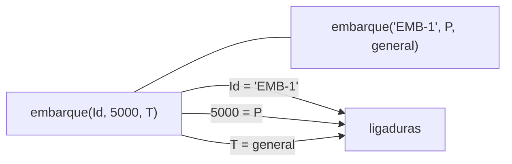

# Taller 6 · Unificación paso a paso

Unidad 4 · Prolog · **individual**
**Entrega: martes 10 de noviembre, 23:59** · `talleres/10-nov/<tu número de control>/`

En Prolog no hay asignación: hay **unificación**. Dos términos unifican si existe una forma de
ligar sus variables para que queden idénticos. Es lo que hace el motor en cada paso: toma la
consulta, busca una cláusula cuya cabeza unifique, liga las variables y sigue con el cuerpo. Hoy lo
haces tú a mano, y luego escribes tres predicados donde la cabeza decide por ti.

**Entregas:** tu `respuestas.md` y tu `unificacion.pl` con las 9 pruebas en verde.

```bash
cd programacion-multiparadigma-2026
git pull
cd 11-unificacion
```

Sin `swipl` instalado: abre <https://swish.swi-prolog.org>, pega `unificacion.pl` en el panel
izquierdo y consulta en el derecho. Para las pruebas, pega también el contenido de `pruebas.plt`
debajo y consulta `?- run_tests.`

---

## Paso 1 · Las cuatro reglas de la unificación

1. Una **constante** (`colombia`, `5000`, `'EMB-1'`) unifica solo consigo misma.
2. Una **variable** (empieza con mayúscula o con `_`) unifica con cualquier cosa, y **se liga** a ella.
   Una vez ligada, vale eso en todo lo que sigue.
3. Dos **términos compuestos** unifican si tienen el mismo nombre, el mismo número de argumentos, y
   cada argumento unifica con el de enfrente.
4. Una **lista** `[C | R]` es un término compuesto: `C` es el primer elemento y `R` es el resto (otra
   lista, puede ser `[]`).



Las ligaduras van **en las dos direcciones**: `Id` toma `'EMB-1'`, pero también `P` toma `5000`.

## Paso 2 · Trazar a mano

En `respuestas.md`, para cada par: ¿unifican? Si sí, escribe **todas** las ligaduras; si no, la regla
que lo impide. Hazlo **antes** de probarlo en SWISH; luego comprueba con `?- Término1 = Término2.`

| # | Término 1 | Término 2 |
|---|---|---|
| 1 | `embarque(Id, 5000, T)` | `embarque('EMB-1', P, general)` |
| 2 | `cotizacion(A, B)` | `cotizacion(1, 2, 3)` |
| 3 | `[X \| R]` | `[a, b, c]` |
| 4 | `[X, Y]` | `[a, b, c]` |
| 5 | `puente(colombia)` | `puente(Colombia)` |
| 6 | `f(X, X)` | `f(a, b)` |
| 7 | `f(X, Y)` | `f(Y, a)` |
| 8 | `ok(Id, cotizacion(_, T))` | `ok('EMB-2', cotizacion(950150, 950150))` |
| 9 | `ok(_, cotizacion(T, T))` | `ok(x, cotizacion(1, 2))` |
| 10 | `[C \| R]` | `[]` |

<details><summary>Explicación (ábrela después de contestar)</summary>

1. Sí: `Id = 'EMB-1'`, `P = 5000`, `T = general`.
2. No: mismo nombre, pero 2 argumentos contra 3 (regla 3).
3. Sí: `X = a`, `R = [b, c]`.
4. No: `[X, Y]` es una lista de **exactamente** dos; `[a, b, c]` tiene tres.
5. Sí: `Colombia = colombia`. `colombia` (minúscula) es una constante; `Colombia` (mayúscula) es una
   variable. Es el error más común de la unidad.
6. No: `X` se liga a `a` en el primer argumento; en el segundo, `X` ya vale `a` y `a` no unifica con `b`.
7. Sí: `X = Y` (primer argumento), y luego `Y = a`, así que `X = a` y `Y = a`.
8. Sí: `Id = 'EMB-2'`, `T = 950150`. El `_` unifica con `950150` y no guarda nada.
9. No: `T = 1` en el primer argumento de `cotizacion`; luego `T` (que vale `1`) contra `2` falla.
10. No: `[C | R]` necesita al menos un elemento; `[]` no tiene ninguno. Por eso la recursión sobre
    listas tiene una cláusula para `[]` y otra para `[C | R]`.
</details>

## Paso 3 · Que la cabeza decida

Abre `unificacion.pl`. Los tres predicados están en `fail`; escríbelos **sin `=`, sin `==`, sin
`->`**: la decisión va en el patrón de la cabeza, como las cláusulas de `validar` en su motor.

1. `mismo_puente(E1, E2)`: los dos embarques cruzan por el mismo puente. Un embarque es
   `embarque(Id, PesoKg, Tipo, Puente, Documentos)`.
2. `falta(Embarque, Doc)`: el tipo del embarque requiere `Doc` y la lista `Documentos` no lo trae.
3. `aplica_descuento(PesoKg, descuento(UmbralKg, Pct, Criterio))`: dos cláusulas, una por criterio.

```bash
swipl -g run_tests -t halt pruebas.plt
```

Con el archivo tal como viene, 4 pruebas fallan. Con los tres predicados escritos, pasan las 9.

<details><summary>Pista · mismo_puente</summary>

Si la **misma variable** aparece dos veces en la cabeza, los dos lugares tienen que unificar con lo
mismo. Es el ejercicio 6 del paso 2, usado a tu favor: `mismo_puente(embarque(_, _, _, P, _), embarque(_, _, _, P, _)).`
sin cuerpo.
</details>

<details><summary>Pista · falta</summary>

`requiere(Tipo, Doc)` te da el documento que el tipo exige. "No lo trae" es `\+ member(Doc, Docs)`.
El `\+` es "no se puede demostrar".
</details>

<details><summary>Pista · aplica_descuento</summary>

`aplica_descuento(Peso, descuento(U, _, a_partir_de)) :- Peso >= U.` Y la otra cláusula con `mas_de`
y `>`. El criterio se decide por el átomo que está en la cabeza; nadie lo compara en el cuerpo.
</details>

## Paso 4 · La pregunta del checkpoint

En `respuestas.md`: `?- aplica_descuento(8000, descuento(8000, 5, mas_de)).` ¿Qué cláusula intenta
Prolog primero? ¿Qué pasa en la cabeza? ¿Y en la segunda? Escríbelo paso a paso, como un trazo.

---

## Entregar

En el repositorio de tu equipo, **antes del martes 10 a las 23:59**:

```bash
cd cotizador-eNN
git switch main && git pull
git switch -c taller/10-nov-<control>

mkdir -p talleres/10-nov/<control>
cp ../programacion-multiparadigma-2026/11-unificacion/unificacion.pl talleres/10-nov/<control>/
cp ../programacion-multiparadigma-2026/11-unificacion/respuestas-plantilla.md talleres/10-nov/<control>/respuestas.md
# llena respuestas.md

git add talleres
git commit -m "docs: entrega del taller unificación paso a paso"
git push -u origin taller/10-nov-<control>
```

Abre el PR. Tu compañero lo aprueba y lo integra con **Create a merge commit**.

La carpeta se llama `talleres` (minúscula) y la fecha `10-nov`, exactamente así.
