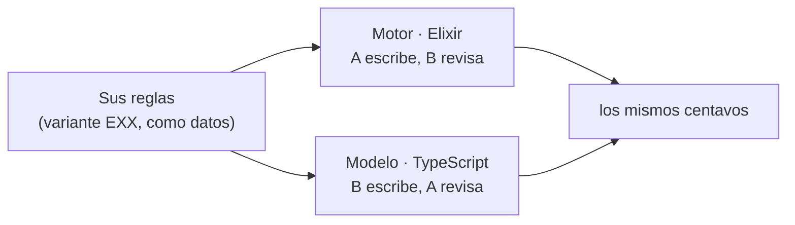

# Arranque del proyecto

**Lunes 12 de octubre** · en pareja
Al terminar: el motor creado, sus pruebas corriendo en CI y **una prueba en verde integrada por PR**.

> **El proyecto en una frase.** Van a escribir **el mismo cotizador dos veces**: una en Elixir,
> donde no se puede mutar (el **motor**, hito 1 el **miércoles 21**), y otra en TypeScript, con tipos
> que no dejan escribir un estado imposible (el **modelo**, entrega final el **jueves 29**). Las dos
> tienen que dar **los mismos centavos**.



---

## Paso 0 · Su equipo

Confirmen quién es **A** y quién es **B**. En esta unidad **A escribe el motor y B revisa cada PR**;
en la unidad 3 se invierte. En la defensa, a A se le pregunta por el modelo y a B por el motor.

## Paso 1 · Leer el enunciado (los dos)

Lean completo `proyecto/PROYECTO-PARCIAL-2.md`. Luego abran
`proyecto/variantes-tarifarias.md` y busquen **su** variante (la de su número de equipo).

Fíjense en las dos reglas que cambian entre equipos:

1. **El criterio del descuento:** unos dicen *"a partir de 8,000 kg"* (8,000 sí cuenta) y otros
   *"más de 10,000 kg"* (10,000 no cuenta).
2. **La base del recargo:** unos calculan el porcentaje sobre **el flete**, otros sobre **el flete
   más la cuota del puente**.

## Paso 2 · Una cuenta a mano (los dos)

El ejemplo del enunciado, con las reglas de E01: refrigerada, 9,000 kg, 200 km, puente Colombia.

| Paso | Cuenta | Centavos |
|---|---|---|
| Flete bruto | 200 × 3950 | 790000 |
| Descuento (5 %, a partir de 8,000 kg: **sí** aplica) | (790000 × 5 + 50) div 100 | 39500 |
| Flete | 790000 − 39500 | 750500 |
| Cuota Colombia | | 42000 |
| Recargo (18 % sobre **flete + cuota**, más $150) | (792500 × 18 + 50) div 100 + 15000 | 157650 |
| Total | 750500 + 42000 + 157650 | **950150** |

**Ahora ustedes:** hagan la misma cuenta **con las reglas de su variante**.

<details><summary>Pregunta de control: si E01 calculara el recargo solo sobre el flete, ¿cuánto daría?</summary>

(750500 × 18 + 50) div 100 + 15000 = **150090**, en lugar de 157650.
</details>

Para saber si su cuenta está bien, abran `proyecto/aceptacion/EXX/visibles/aceptacion_test.exs`
(su número). La prueba **"refrigerada paga su recargo"** trae un embarque y el total esperado: hagan
esa cuenta a mano y comparen.

## Paso 3 · Crear el motor (A escribe; B mira)

En la carpeta de su repositorio, **en una rama**:

```bash
cd cotizador-eNN
git switch main && git pull
git switch -c feat/motor

mix new motor --module Cotizador
rm motor/test/cotizador_test.exs
```

`mix new` crea una prueba de ejemplo (`cotizador_test.exs`) que no es suya: bórrenla.

Ahora copien **sus** pruebas y el CI. Supone que el repositorio del curso está clonado junto al suyo
(cambien `EXX` por su número):

```bash
cp ../programacion-multiparadigma-2026/proyecto/aceptacion/EXX/visibles/aceptacion_test.exs motor/test/
mkdir -p .github/workflows
cp ../programacion-multiparadigma-2026/proyecto/plantilla-motor/motor.yml .github/workflows/motor.yml
```

El CI va en `.github/workflows/` **de la raíz** del repositorio, no dentro de `motor/`, junto al flujo
de TypeScript de la unidad 1.

## Paso 4 · Ver todo en rojo (los dos)

```bash
cd motor
mix test
```

Debe salir **16 pruebas, 16 fallas**: es su lista de pendientes. Lean los nombres de las pruebas: cada
una es una regla de negocio.

## Paso 5 · La primera prueba en verde (A escribe; B revisa)

Abran `motor/lib/cotizador.ex`, borren todo lo que trae (es un ejemplo de `mix new`) y escriban:

```elixir
defmodule Cotizador do
  def cotizar(%{peso_kg: p}, _reglas) when p <= 0, do: {:error, :peso_invalido}
end
```

```bash
mix test
```

Debe salir **16 pruebas, 15 fallas**. Pasó *"rechaza peso cero"*.

Usaron **un patrón de mapa** (`%{peso_kg: p}` pide solo esa llave), **una guarda** (`when p <= 0`) y
**un resultado** (`{:error, motivo}`).

Las otras fallan casi todas con `FunctionClauseError`: llega un embarque y **ninguna cláusula lo
acepta**. Cada cláusula que agreguen pone otra en verde.

## Paso 6 · PR, revisión e integración (los dos)

```bash
mix format
cd ..
git add motor .github/workflows/motor.yml
git commit -m "feat: motor en Elixir con la validación de peso"
git push -u origin feat/motor
```

Sin `mix format`, el CI falla en `mix format --check-formatted`.

En GitHub:

1. A abre el PR y pide la revisión de B.
2. **B lee el cambio** y deja un comentario contestando: *¿qué hace la guarda `when p <= 0`, y qué pasa
   si llega un peso de 0?*
3. Esperen el check del CI. Sale en rojo porque 15 pruebas fallan. Revisen que el paso que falla sea
   **`mix test`**, no `mix format` ni la compilación.
4. B aprueba e integran con **Create a merge commit**.

Hasta el hito 1 se integra con el CI en rojo **solo** por pruebas pendientes. Desde el hito 1, `main`
va siempre en verde.

5. Peguen en el canal de Teams la liga del PR integrado, con su número de equipo.

## Lista de verificación

- [ ] Saben quién es A y quién es B
- [ ] Hicieron a mano la cuenta de la prueba "refrigerada paga su recargo" de su variante
- [ ] `motor/` existe, con `lib/cotizador.ex` y `test/aceptacion_test.exs`
- [ ] `.github/workflows/motor.yml` está en la raíz y aparece en la pestaña **Actions**
- [ ] `mix test` da 16 pruebas, 15 fallas
- [ ] El PR está integrado y la liga está en Teams

## Problemas típicos

| Síntoma | Qué pasa |
|---|---|
| `mix: command not found` | Elixir no está instalado: `INSTALACION-ELIXIR.md`. Mientras, trabajen en la máquina del compañero. |
| El CI de Elixir no aparece en Actions | El archivo no está en `.github/workflows/` de la raíz, o Actions está deshabilitado (pestaña Actions, habilitar flujos). |
| Falla `mix format --check-formatted` | Corran `mix format` dentro de `motor/` y hagan commit otra vez. |
| `module Cotizador is not available` en todas | El módulo no se llama `Cotizador`: revisen la primera línea de `lib/cotizador.ex`. |
| Salen más de 16 pruebas, o una que dice `greets the world` | No borraron `motor/test/cotizador_test.exs`. |

**Siguiente:** `proyecto/GUIA-DEL-MOTOR.md`, por etapas, hasta el hito del miércoles 21.
