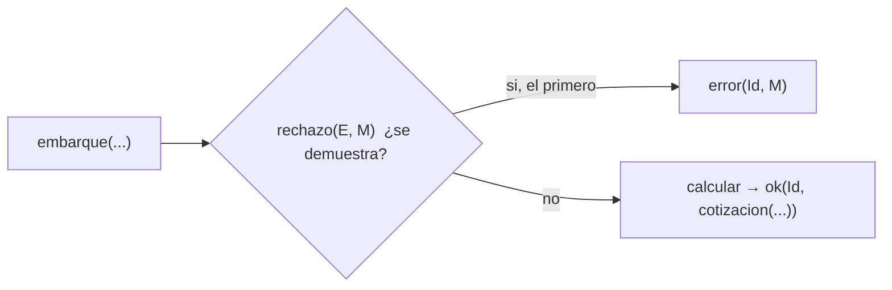
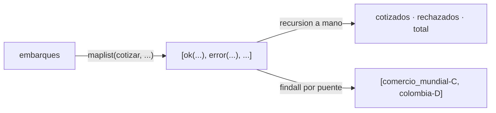

# Guía de las reglas · por etapas, hasta la entrega

**Entrega: viernes 20 de noviembre, 23:59** · etiqueta `reglas` en `main`

Sus 16 pruebas de aceptación en Prolog se agrupan en **tres etapas**, más una cuarta de SQL. Cada
etapa es **una rama y un PR**: A escribe, B revisa con la lista del final, e integran.

| Etapa | Pruebas | Lo que usan | Meta |
|---|---|---|---|
| 1 · Los rechazos | las 7 que empiezan con **"rechaza"** | cláusulas, `\+`, `once` | **miércoles 11** |
| 2 · El flete | "por debajo del umbral", "EXACTAMENTE en el umbral", "un kilo arriba", "puente Colombia" | `is`, `//`, cláusulas por criterio | **viernes 13** |
| 3 · Recargos, mínimo y resumen | "refrigerada", "peligrosa", "sobredimensionada… peso máximo", "viaje corto", "lote mixto" | `max`, recursión, `findall` | **miércoles 18** |
| 4 · Las consultas SQL | `resumen.sql` contra `cotizaciones.db` | `GROUP BY`, `ORDER BY`, `IS NULL` | **jueves 19** |

Las **pistas** están escondidas: ábranlas solo después de intentarlo.

---

## Antes de la etapa 1 · Los archivos

```bash
cd cotizador-eNN
git switch main && git pull
git switch -c feat/reglas-rechazos
mkdir reglas
cp ../programacion-multiparadigma-2026/proyecto/aceptacion-prolog/EXX/visibles/variante.pl reglas/
cp ../programacion-multiparadigma-2026/proyecto/aceptacion-prolog/EXX/visibles/aceptacion.plt reglas/
cp ../programacion-multiparadigma-2026/proyecto/plantilla-reglas/reglas.yml .github/workflows/
```

`variante.pl` **no se edita**: son sus reglas como hechos. Ábranlo y compárenlo con su variante en
`variantes-tarifarias.md`: cada número está ahí, uno por hecho.

`reglas/cotizador.pl` empieza así, y esa es **toda** la forma del programa:

```prolog
:- consult(variante).

% rechazo(+Embarque, -Motivo): una clausula por motivo, en el orden del enunciado
% calcular(+Embarque, -Cotizacion)

cotizar(E, error(Id, Motivo)) :- E = embarque(Id, _, _, _, _, _, _), once(rechazo(E, Motivo)), !.
cotizar(E, ok(Id, C)) :- E = embarque(Id, _, _, _, _, _, _), \+ rechazo(E, _), calcular(E, C).
```



Es el `with` de su motor, en Prolog: `once(rechazo(E, M))` toma **el primer motivo** que se demuestre
(el orden de las cláusulas es el orden del enunciado), y `\+ rechazo(E, _)` dice "no hay ningún
motivo". Los archivos de Prolog van **sin acentos** en los comentarios: evita errores de codificación
entre máquinas.

Las pruebas se corren dentro de `reglas/`:

```bash
swipl -g run_tests -t halt aceptacion.plt
```

Con el archivo así (sin `rechazo/2` ni `calcular/2`), las 16 fallan por "procedimiento desconocido".

---

## Etapa 1 · Los rechazos (meta: miércoles 11)

`rechazo/2` es **una cláusula por motivo, en el orden del enunciado**. La decisión va en la cabeza
(patrón) o en el cuerpo (guarda aritmética). Las dos primeras:

```prolog
rechazo(embarque(_, Peso, _, _, _, _, _), peso_invalido) :- Peso =< 0.
rechazo(embarque(_, _, Dist, _, _, _, _), distancia_invalida) :- Dist =< 0.
```

Escriban las otras cinco **debajo, en orden**. Ni un `->`: cada decisión es una cláusula.

Mientras llegan a la etapa 2, `calcular/2` regresa una cotización en ceros, para que las pruebas de
`cotizar` fallen por el valor y no porque falte el predicado:

```prolog
calcular(_, cotizacion(0, 0, 0, 0, 0, 0, 0)).
```

<details><summary>Pista · tipo_desconocido y puente_desconocido</summary>

Un tipo es válido si tiene recargo en la variante: `recargo(Tipo, _, _)`. Un puente es válido si
tiene cuota: `cuota_puente(Puente, _)`. "Desconocido" es que **no se puede demostrar**: `\+ recargo(Tipo, _, _)`.
Las listas de tipos y puentes no se escriben en el programa: están en los hechos.
</details>

<details><summary>Pista · falta_numero_un y falta_permiso</summary>

Sin cuerpo. El patrón lo dice todo: `rechazo(embarque(_, _, _, peligrosa, _, none, _), falta_numero_un).`
Es el ejercicio 1 del taller 6.
</details>

<details><summary>Pista · excede_peso_maximo (la trampa de la etapa)</summary>

La sobredimensionada **no tiene** peso máximo. En Elixir lo resolvieron con una cláusula que la dejaba
pasar antes. En Prolog, con `once`, el truco es otro: la cláusula del peso máximo tiene que **excluirla
ella misma**: `Tipo \== sobredimensionada, peso_maximo(Max), Peso > Max`. Si no la excluyen, la
sobredimensionada con permiso se rechaza y la prueba "puede pasar del peso maximo" falla en la etapa 3.
</details>

**Listo cuando:** `swipl -g run_tests -t halt aceptacion.plt` dice **9 tests failed, 7 tests passed**, y
ninguna de las 9 empieza con "rechaza".

---

## Etapa 2 · El flete (meta: viernes 13)

Ahora `calcular/2`: flete bruto, descuento, flete y cuota del puente. Recargo y ajuste al mínimo
todavía en 0 (las cuatro pruebas de esta etapa son carga general: su recargo **es** 0).

**El redondeo**, una sola vez, es el fragmento 5 del jueves:

```prolog
pct(Monto, P, R) :- R is (Monto * P + 50) // 100.
```

**El descuento** depende del criterio de su variante. Es el predicado 3 del taller 6, con los hechos de
`variante.pl` en lugar del término `descuento(...)` como argumento:

```prolog
aplica_descuento(Peso) :- descuento(Umbral, _, a_partir_de), Peso >= Umbral.
aplica_descuento(Peso) :- descuento(Umbral, _, mas_de), Peso > Umbral.
```

Tracen a mano la prueba "EXACTAMENTE en el umbral" con su criterio antes de escribir lo que sigue.

<details><summary>Pista · el monto del descuento, con corte</summary>

```prolog
monto_descuento(Peso, Bruto, D) :- aplica_descuento(Peso), !, descuento(_, P, _), pct(Bruto, P, D).
monto_descuento(_, _, 0).
```
El `!` evita que, si aplicó el descuento, Prolog **también** pruebe la segunda cláusula y regrese un
segundo resultado con descuento 0. Sin el corte, la prueba pasa y en SWISH la consulta da dos
respuestas: ese es el defecto que se pregunta en la defensa.
</details>

<details><summary>Pista · calcular, por ahora</summary>

```prolog
calcular(embarque(_, Peso, Dist, _, Puente, _, _), cotizacion(Bruto, Desc, Flete, Cuota, 0, 0, Total)) :-
    tarifa_km(Tarifa),
    Bruto is Dist * Tarifa,
    monto_descuento(Peso, Bruto, Desc),
    Flete is Bruto - Desc,
    cuota_puente(Puente, Cuota),
    Total is Flete + Cuota.
```
Cada `is` necesita sus variables **ya ligadas**: por eso `tarifa_km(Tarifa)` va antes de usar
`Tarifa`. El orden de las metas en el cuerpo es el orden en que se calculan.
</details>

**Listo cuando:** **5 tests failed, 11 tests passed**.

---

## Etapa 3 · Recargos, mínimo y resumen (meta: miércoles 18)

- **La base** del recargo depende de `base_recargo/1`: `flete` o `subtotal` (flete más cuota). Igual
  que el criterio: **dos cláusulas**.
- `recargo(Tipo, Pct, Fija)` les da el porcentaje y la cuota fija del tipo. El recargo es
  `pct(Base, Pct)` más la fija.
- El total nunca baja de `minimo/1`; `AjusteMinimo` es lo que se sumó para llegar (casi siempre 0).
  `max/2` existe dentro de `is`: `Total is max(Calc, Min)`.

Hagan a mano la prueba "refrigerada paga su recargo" de su variante: si la cuenta a mano no da, el
código tampoco.

**El resumen.** `resumen(Embarques, resumen(Cotizados, Rechazados, Total, PorPuente))`:



<details><summary>Pista · maplist y la recursión</summary>

`maplist(cotizar, Embarques, Resultados)` aplica `cotizar/2` a cada embarque: es el `Enum.map`. Luego,
tres predicados recursivos sobre `Resultados`, con la forma de `suma/2` del jueves:

```prolog
cotizados([], 0).
cotizados([ok(_, _) | R], N) :- cotizados(R, N0), N is N0 + 1.
cotizados([error(_, _) | R], N) :- cotizados(R, N).
```
`rechazados/2` construye la lista `[Id-Motivo, ...]` en el orden en que vienen (la recursión ya lo
respeta: no hay nada que invertir). `total/2` suma el último campo de cada `cotizacion(...)`.
</details>

<details><summary>Pista · por puente, siempre los dos</summary>

`findall(P-S, (cuota_puente(P, _), suma_puente(Embarques, Resultados, P, S)), PorPuente)`: recorre
los puentes **de la variante** (por eso salen los dos aunque uno sume 0) y para cada uno suma los
totales de los embarques que cruzan por ahí. `suma_puente/4` recorre las dos listas a la vez.
</details>

**Listo cuando:** **All 16 tests passed**, y en SWISH `?- resumen([...], R).` regresa **una sola**
respuesta (si al pedir `;` aparece otra, hay un corte que falta).

---

## Etapa 4 · Las consultas SQL (meta: jueves 19)

Viene con el taller 7 (`12-sql-declarativo/`, martes 17). Ahí está `cotizaciones.db` y la
descripción de las tres consultas de `reglas/resumen.sql`. Se comprueban con:

```bash
sqlite3 cotizaciones.db < resumen.sql
```

y se comparan con `12-sql-declarativo/esperado.txt`.

---

## La entrega (viernes 20)

```bash
git switch main && git pull
cd reglas && swipl -g run_tests -t halt aceptacion.plt && cd ..
git tag reglas
git push origin reglas
```

La etiqueta es lo que se califica, a las 23:59.

---

## Para B: cómo revisar cada PR

- [ ] ¿Hay algún **número de la variante** escrito en `cotizador.pl`? Todo sale de `variante.pl`.
- [ ] ¿Hay algún `->` o `;` decidiendo por **tipo de carga** o por **criterio**? Eso va en cláusulas.
- [ ] ¿El orden de las cláusulas de `rechazo/2` sigue el orden del enunciado?
- [ ] En SWISH, `?- cotizar(<un embarque>, R).` ¿da **una** respuesta, o al pedir `;` sale otra?
- [ ] Escojan **un** predicado del PR y escriban en un comentario, con sus palabras, qué hace y cuál
      es su caso base (si es recursivo).
