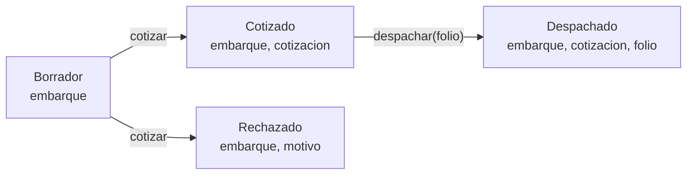

# Guía del modelo · TypeScript

**Entrega final (motor + modelo): jueves 29 de octubre, 23:59** · etiqueta `parcial-2` en `main`

En esta parte **B escribe y A revisa**. El modelo es el mismo cotizador que el motor, en TypeScript,
y tiene que dar **los mismos centavos**. Lo nuevo es la pregunta: **qué estados puede tener un
embarque, y cómo hacer que el compilador no deje escribir los que no existen.**

Antes de empezar, hagan la **guía 08** (`08-uniones/GUIA.md`) y el **taller 4** (`07-despacho`): son
las dos técnicas de esta guía, practicadas en otro dominio.

| Etapa | Meta | Listo cuando |
|---|---|---|
| 0 · Arranque | | Las pruebas corren, todas en rojo |
| 1 · Los tipos | **sábado 24** | `npm run typecheck` en verde |
| 2 · `cotizar` | **martes 27** | 11 de 12 pruebas |
| 3 · `despachar` | **miércoles 28** | `npm run verificar` en verde |

---

## Etapa 0 · Arranque

```bash
cd cotizador-eNN
git switch main && git pull
git switch -c feat/modelo
cp ../programacion-multiparadigma-2026/proyecto/aceptacion/EXX/visibles/aceptacion.test.ts tests/
```

Creen `src/modelo.ts` con esto, para que las pruebas encuentren lo que importan:

```ts
export type Puente = 'comercio_mundial' | 'colombia';
export type Borrador = unknown;
export type Cotizado = unknown;
export type Rechazado = unknown;
export type Despachado = unknown;
export type Reglas = unknown;

export function cotizar(_b: Borrador, _r: Reglas): Cotizado | Rechazado {
  throw new Error('por implementar');
}

export function despachar(_c: Cotizado, _folio: string): Despachado {
  throw new Error('por implementar');
}
```

El `_` al inicio de un parámetro le dice al linter que todavía no se usa.

```bash
npm run typecheck
npm test
```

Sale todo en rojo: errores de tipos y 12 pruebas. Abran el final de `tests/aceptacion.test.ts`: las
**ocho** líneas con `@ts-expect-error` son estados que **no deben compilar** en su modelo.

---

## Etapa 1 · Los tipos (meta: sábado 24)

Lo que tienen que definir, con los nombres de campo de las pruebas:



1. **Los cuatro estados**, como unión discriminada por `estado` (guía 08, sección 2).
2. **La carga**, como unión discriminada por `tipo`: `general`, `refrigerada`, `peligrosa` con
   `numeroUn`, `sobredimensionada` con `permiso`. Una peligrosa sin número UN no existe.
3. **El embarque**: `id`, `pesoKg`, `distanciaKm`, `puente`, más la carga.
4. **`Cotizacion`**: `id`, `fleteBruto`, `descuento`, `flete`, `cuotaPuente`, `recargo`,
   `ajusteMinimo`, `total`.
5. **`Motivo`**: solo tres, `'peso_invalido' | 'distancia_invalida' | 'excede_peso_maximo'`.
6. **`Reglas`**: lean el objeto `REGLAS` al inicio de sus pruebas; cada llave es un campo.
7. **`Resultado<T, E>`** (guía 08, sección 3).

<details><summary>Pista · embarque = datos comunes + carga</summary>

Los datos que tiene todo embarque van en un tipo, la carga en otro, y se juntan con `&`:

```ts
type Embarque = Datos & Carga;
```

`A & B` es "tiene todo lo de A **y** todo lo de B". Como `Carga` es una unión, el embarque hereda la
regla: si `tipo` es `'peligrosa'`, exige `numeroUn`.
</details>

<details><summary>Pista · los tipos de carga, sin escribirlos dos veces</summary>

`Carga['tipo']` es la unión de todos los `tipo` de `Carga`. Úsenla para `Reglas.recargo`:
`Record<Carga['tipo'], { pct: number; fija: number }>`.
</details>

**¿Por qué solo tres motivos?** En Elixir había siete. Los otros cuatro (tipo desconocido, puente
desconocido, peligrosa sin UN, sobredimensionada sin permiso) **ya no se pueden escribir**: no
compilan. Esa diferencia es una pregunta segura de la defensa.

**Listo cuando:** `npm run typecheck` en verde. Las pruebas siguen en rojo.

---

## Etapa 2 · `cotizar` (meta: martes 27)

Es el mismo cálculo del motor:

- **Validar** regresa `Resultado<Embarque, Motivo>`, con los tres motivos en el orden del enunciado.
- **El peso máximo** no aplica a la sobredimensionada. Esa diferencia por tipo va en una **tabla de
  políticas** (taller 4), no en un `if` sobre el tipo.
- **Calcular**: flete bruto, descuento, flete, cuota, recargo, mínimo.
- **El redondeo:** en TypeScript no hay `div`. `Math.floor((monto * p + 50) / 100)` da lo mismo que el
  `div(monto * p + 50, 100)` de Elixir con montos positivos.

<details><summary>Pista · el criterio y la base del recargo</summary>

Son datos de las reglas (`'a_partir_de' | 'mas_de'`, `'flete' | 'subtotal'`), no tipos de carga.
Un ternario sobre esos datos está permitido. Lo que no se permite es decidir por **tipo de carga**
fuera de la tabla.
</details>

**Los mismos centavos.** Tomen una prueba y corran el mismo embarque en el motor (`iex -S mix` dentro
de `motor/`) y en el modelo. Si no coinciden, uno de los dos está mal.

**Listo cuando:** 11 de 12 pruebas (falta la de `despachar`).

---

## Etapa 3 · `despachar` (meta: miércoles 28)

Recibe un `Cotizado` y un folio, y regresa un `Despachado` **nuevo**. Por la firma, despachar un
borrador o un rechazado no compila: eso ya lo verifican dos de las ocho líneas.

**Listo cuando:** `npm run verificar` en verde: tipos, linter y 12 pruebas.

---

## Lo que se revisa en la defensa

- Cero `switch` o cadenas de `if` sobre el **tipo de carga**: la tabla de políticas.
- **Composición, no herencia**: el cálculo son funciones pequeñas que se encadenan. Si usan una clase
  base, tienen que poder defenderla contra la alternativa.
- `Resultado<T, E>` en la validación.
- `tsconfig.json` incluye `tests` (ya viene así en su plantilla): sin eso, `tsc` no revisa las ocho
  líneas.

## La entrega final (jueves 29)

```bash
git switch main && git pull
npm run verificar
cd motor && mix test && mix format --check-formatted && cd ..
git tag parcial-2
git push origin parcial-2
```

## Para A: cómo revisar cada PR

- [ ] ¿Hay un `switch` o un `if` que decide por **tipo de carga**?
- [ ] ¿Hay algún **número de su variante** escrito en el código?
- [ ] ¿Algún campo opcional (`?`) deja escribir un estado imposible?
- [ ] Escojan **un** tipo del PR y expliquen en un comentario qué estado imposible evita.
