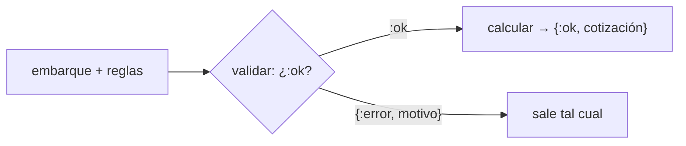
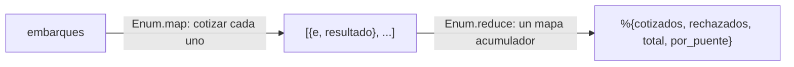

# Guía del motor · por etapas, hasta el hito 1

**Hito 1: miércoles 21 de octubre, 23:59** · etiqueta `hito-1` en `main`

Sus 16 pruebas de aceptación se agrupan en **cuatro etapas**. Cada etapa es **una rama y un PR**: A
escribe, B revisa con la lista del final, e integran.

| Etapa | Pruebas | Lo que usan | Meta |
|---|---|---|---|
| 1 · Los rechazos | las 7 que empiezan con **"rechaza"** | patrones, guardas, `with` | **miércoles 14** |
| 2 · El flete | "por debajo del umbral", "EXACTAMENTE en el umbral", "un kilo arriba", "puente Colombia" | aritmética entera, cláusulas | **viernes 16** |
| 3 · Recargos y mínimo | "refrigerada", "peligrosa", "sobredimensionada… peso máximo", "viaje corto" | `Map.fetch!`, cláusulas | lunes 19 |
| 4 · El resumen | "lote mixto" | `\|>`, `Enum.reduce`, mapas | martes 20 |

Las **pistas** están escondidas: ábranlas solo después de intentarlo.

---

## La forma de todo el motor

Antes de la etapa 1, que A escriba esta forma. Es la guía 05 aplicada: **validar, y solo si pasa,
calcular.**

```elixir
defmodule Cotizador do
  def cotizar(embarque, reglas) do
    with :ok <- validar(embarque, reglas) do
      {:ok, calcular(embarque, reglas)}
    end
  end

  # validar/2 regresa :ok o {:error, motivo}
  # calcular/2 regresa el mapa de la cotización
end
```



Si `validar` regresa `{:error, :peso_invalido}`, eso no encaja con `:ok`, y `with` lo regresa sin
tocarlo. Es el fragmento 6 de la guía 05.

---

## Etapa 1 · Los rechazos (meta: miércoles 14)

`validar/2` es **una cláusula por motivo, en el orden del enunciado**. El orden importa: un embarque con
peso 0 **y** puente inexistente se rechaza por el peso, porque esa cláusula está primero.

Las dos primeras:

```elixir
defp validar(%{peso_kg: p}, _reglas) when p <= 0, do: {:error, :peso_invalido}
defp validar(%{distancia_km: d}, _reglas) when d <= 0, do: {:error, :distancia_invalida}
```

Y la última, para todo lo que pasó las anteriores:

```elixir
defp validar(_embarque, _reglas), do: :ok
```

Escriban las otras cinco **en medio**, en orden. **Ni un `if`:** cada decisión es una cláusula.

<details><summary>Pista · tipo_desconocido</summary>

Los tipos válidos son cuatro. Pongan la lista en un atributo del módulo
(`@tipos [:general, :refrigerada, :peligrosa, :sobredimensionada]`) y usen la guarda `when t not in @tipos`.
</details>

<details><summary>Pista · puente_desconocido</summary>

Los puentes válidos son las llaves de `reglas.cuota_puente`. Hay una guarda que pregunta si un mapa
tiene una llave: `is_map_key(mapa, llave)`. Aquí la necesitan negada.
</details>

<details><summary>Pista · falta_numero_un y falta_permiso</summary>

No necesitan guarda: el patrón solo lo dice. Un mapa con `tipo: :peligrosa` **y** `numero_un: nil` es
exactamente el caso que se rechaza.
</details>

<details><summary>Pista · excede_peso_maximo (la trampa de la etapa)</summary>

La sobredimensionada **no tiene** peso máximo. Si la cláusula del peso máximo va sola, también rechaza
a la sobredimensionada. La salida: **antes** de la del peso máximo, una cláusula que diga que una
sobredimensionada (que ya pasó la revisión del permiso) está bien. Las cláusulas se prueban de arriba
hacia abajo: la primera que encaja, gana.
</details>

**Listo cuando:** `mix test` da 16 pruebas y 9 fallas, y ninguna de las 9 empieza con "rechaza".

¿Y `calcular/2`? Mientras llegan a la etapa 2, que regrese un mapa vacío (`%{}`): así compila y las
pruebas de cotizar fallan por el valor, no porque falte la función.

---

## Etapa 2 · El flete (meta: viernes 16)

Ahora `calcular/2`. En esta etapa: flete bruto, descuento, flete y cuota del puente. El recargo y el
mínimo todavía en 0 (la prueba "por debajo del umbral" es carga general: su recargo **es** 0).

**El redondeo,** que va a usar todo lo que tenga porcentaje. Viene en el enunciado; escríbanlo una vez:

```elixir
# un porcentaje, redondeado al centavo, las mitades hacia arriba
defp pct(monto, p), do: div(monto * p + 50, 100)
```

**El descuento** depende del criterio de su variante, y ahí está la prueba "EXACTAMENTE en el
umbral". Tracen esa prueba a mano antes de escribir: con su criterio, ¿el peso exacto lleva
descuento o no?

<details><summary>Pista · el criterio, sin if</summary>

Una función con dos cláusulas que reciba el peso y `reglas.descuento`, y decida con el patrón del
criterio (`%{criterio: :a_partir_de, umbral_kg: u}` contra `%{criterio: :mas_de, umbral_kg: u}`) y
una guarda con `>=` o `>`. Las reglas traen las dos llaves; ustedes no escriben ningún número.
</details>

<details><summary>Pista · la cuota del puente</summary>

`Map.fetch!(reglas.cuota_puente, embarque.puente)`. El `!` es a propósito: si el puente no existiera,
truena. Pero ya no puede pasar, porque `validar` lo rechazó antes.
</details>

**Listo cuando:** pasan las 7 de "rechaza" y las 4 de esta etapa (16 pruebas, 5 fallas).

---

## Etapa 3 · Recargos y mínimo (meta: lunes 19)

- `Map.fetch!(reglas.recargo, embarque.tipo)` les da `%{pct: _, fija: _}`.
- **La base** del porcentaje depende de `reglas.base_recargo`: `:flete` o `:subtotal` (flete más
  cuota). Igual que el criterio: **dos cláusulas**, no un `if`.
- El total nunca baja de `reglas.minimo`; `ajuste_minimo` es lo que se sumó para llegar (casi
  siempre 0). `max/2` existe.

Antes de escribir, hagan a mano la prueba "refrigerada paga su recargo" de su variante (lo hicieron
en el arranque): si su cuenta a mano no da, el código tampoco va a dar.

---

## Etapa 4 · El resumen (meta: martes 20)

`resumen/2` **se escribe con `Enum` y `|>`**:



<details><summary>Pista · el acumulador</summary>

Empiecen con el mapa vacío del resultado: `cotizados: 0`, `rechazados: []`, `total: 0` y `por_puente`
con **los dos puentes en 0** (el enunciado pide que siempre estén). La función del `reduce` tiene dos
cláusulas: una para `{:ok, cotizacion}` y otra para `{:error, motivo}`.
</details>

<details><summary>Pista · los rechazados salen al revés</summary>

Si van pegando cada rechazo al **frente** de la lista (`[nuevo | lista]`), al final quedan al revés:
es el fragmento 7 de la clase de map, filter y reduce. El enunciado pide el orden de llegada.
Inviértanla una sola vez, al final de la tubería.
</details>

**Y la función recursiva a mano.** El enunciado pide al menos una, sobre una lista y sin `Enum`. Por
ejemplo, una auxiliar que sume los totales de una lista de cotizaciones, escrita con la receta de las
tres preguntas, y que de verdad se use.

---

## El hito (miércoles 21)

```bash
git switch main && git pull
cd motor && mix test && mix format --check-formatted && cd ..
git tag hito-1
git push origin hito-1
```

La etiqueta es lo que se califica, a las 23:59. Lo que no esté en la etiqueta no existe.

---

## Para B: cómo revisar cada PR

- [ ] ¿Hay algún `if` o `case` que decide por **tipo de carga** o por **criterio**? Eso va en cláusulas.
- [ ] ¿Hay algún **número de su variante** escrito en el código (3950, 8000, 18…)? Todo sale de `reglas`.
- [ ] ¿El orden de las cláusulas de `validar` sigue el orden del enunciado?
- [ ] Escojan **una** función del PR y escriban en un comentario, con sus palabras, qué hace y por qué así.
